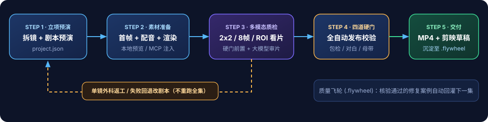
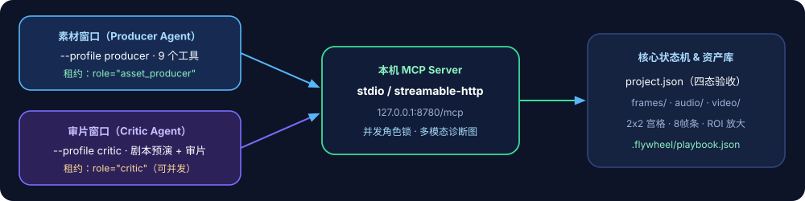

# Story Media Orchestrator 图文并茂新手实战手册

> 本页为 **GitHub 原生直览版**（所有架构图直接渲染，无任何第三方跳转）。如果你已克隆到本地，也可以直接用浏览器双击打开同目录的离线交互版 [`index.html`](index.html)。

---

## 一、端到端工作流全景图



### 10 分钟零门槛上手（零 API Key 可跑通）

```bash
# 1. 安装基础依赖（自带 imageio-ffmpeg，无需手动配置系统 FFmpeg/ffprobe）
pip install -e ".[preview,mcp]"
python -m story_media_orchestrator.cli doctor

# 2. 一句话创建短剧工程
python -m story_media_orchestrator.cli create demo-ep01 "林雾撑伞走过雨夜长街。她停在钟楼门前，抬头望向亮着暖光的阁楼。"

# 3. 零成本跑通预览版成片（MP4）
python -m story_media_orchestrator.cli run demo-ep01 --mode preview --real-preview --tts-source silent --auto

# 4. 一键导出剪映工程草稿
python -m story_media_orchestrator.cli export-jianying demo-ep01
```

详细步骤见：[10 分钟零门槛上手教程](../TUTORIAL_QUICKSTART.md)

---

## 二、成片质量剧本预演 & 视频失败回退改剧本闭环


视频不好看，80% 的根因在前置剧本缺少血肉、因果或把峰值态写成首帧。生图前先跑一次 `rehearse-script`（自动结合历史成片 Demo 飞轮教训 + 分题材缺口 + 6 大剧本硬伤），发现问题精准修单镜或插因果桥，绝不重跑全集：

```bash
# 生图前跑成片质量剧本预演（支持 xianxia / urban_suspense / romance / general）
python -m story_media_orchestrator.cli rehearse-script ./demo-ep01 --genre xianxia

# 视频不过关时，回退修改上游单镜剧本（仅失效该镜视觉缓存，保留配音与其他镜头）
python -m story_media_orchestrator.cli patch-script ./demo-ep01 shot-01 \
  --text "陆南攥紧布囊，将最后半块干粮塞进阿石手里。" --framing "近景" --location "雨夜石寨土墙边"

# 缺动机或反应拍时，在指定镜号后插入因果桥镜
python -m story_media_orchestrator.cli insert-bridge ./demo-ep01 shot-01 \
  --text "阿石眼眶发红，按住陆南手腕又缓缓松开。" --story-role reaction_handoff
```

详细分诊表与硬门禁命令见：[AI 短剧质量验收与低成本返工指南](../TUTORIAL_QA_AND_REWORK.md)

---

## 三、MCP 多 Agent 并发协同架构（Antigravity / Codex / Cursor）



```bash
# 单窗口精简接入（推荐新手，仅暴露核心工具）
python -m story_media_orchestrator.cli mcp --transport streamable-http --host 127.0.0.1 --port 8780 --profile core

# 双窗口专职并发（生图侧 role="asset_producer" + 审片侧 role="critic" 互不撞锁）
python -m story_media_orchestrator.cli mcp --transport streamable-http --port 8781 --profile producer
python -m story_media_orchestrator.cli mcp --transport streamable-http --port 8782 --profile critic
```

完整配置模板与 AI 协作指令见：[MCP 多 Agent 协同接入指南](../TUTORIAL_MCP_AGENT.md)
